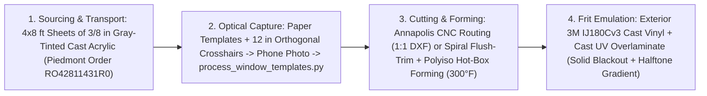

# Acrylic-Port-Refit

**Custom Cast Acrylic Cabin Window Fabrication, OpenCV Template-to-DXF Digitization, & Exterior `3M IJ180Cv3` Halftone Frit Emulation (2003 Hunter 326 & 2009 Beneteau 40 *Novella*)**

`acrylic-port-refit` covers the complete engineering, CAD/CAM optical digitization pipeline, machining/thermoforming workflow, and OEM-style halftone dot-matrix frit border fabrication for refitting `16–20 sq ft` of fixed cabin trunk portlights (including `~8 × 1 ft` curved coachroof side windows) on a **2003 Hunter 326** and a **2009 Beneteau Oceanis 40 (*Novella*)**.

---

## Core Workflow Overview



### Key Engineering Decisions
* **`3/8"` (`9.5 mm`) Cell-Cast Gray Acrylic over Extruded or Polycarbonate:** Sourced in `4 × 8 ft` sheets from Piedmont Plastics (`Order RO42811431R0`). Cell-cast acrylic machines cleanly without gumming flutes, resists solvent/bending stress crazing, and delivers `20+ year` marine UV clarity.
* **Sub-Pixel OpenCV Template-to-DXF Pipeline ([`process_window_templates.py`](process_window_templates.py)):** Traces of original removed windows marked with `12.0"` orthogonal calibration crosshairs are photographed flat (iPhone 17 Pro / Galaxy S26 Ultra) and rectified via planar homography into native `1:1` inch-scaled DXF and SVG files for CNC routing and vinyl print/cut registration.
* **Custom Exterior `3M IJ180Cv3` Halftone Frit Border (`~$150–$250`):**
  * True ceramic enamel frit requires `1,200°F` kiln firing (glass-only), and off-the-shelf dot films lack curved perimeter blackout bands and bubble over outgassing acrylic.
  * Printing a `1:1` vector mask (`100%` solid blackout flange transitioning via a halftone dot-matrix gradient) onto **`3M IJ180Cv3` cast marine wrap vinyl + matched cast UV overlaminate (`3M 8518/8520`)** and applying it to the **EXTERIOR** face blocks UV *before* it enters the acrylic or hits the structural `Sikaflex 295 UV` / `3M VHB` bondline, avoids acrylic outgassing bubbles, and heat-sets permanently at `195°F` (`90°C`).

---

## Repository Contents

* **[`acrylic-window-frit-refit-guide.md`](acrylic-window-frit-refit-guide.md)** — Complete sourcing, sheet transport, digitization, CNC vs. DIY routing, `300°F` hot-box thermoforming, and `3M IJ180Cv3` halftone frit installation guide.
* **[`process_window_templates.py`](process_window_templates.py)** — OpenCV planar homography, sub-pixel crosshair calibration, periodic B-spline smoothing, and `1:1` DXF/SVG profile generator.
* **[`requirements.txt`](requirements.txt)** — Python dependencies (`opencv-python`, `ezdxf`, `numpy`, `scipy`, `matplotlib`).

---

## Quick Start: Running the Template-to-DXF Pipeline

```bash
pip install -r requirements.txt
python3 process_window_templates.py path/to/template_photo.jpg --grid-width 12.0 --grid-height 12.0 --output-dir ./output
```
