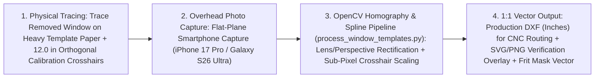
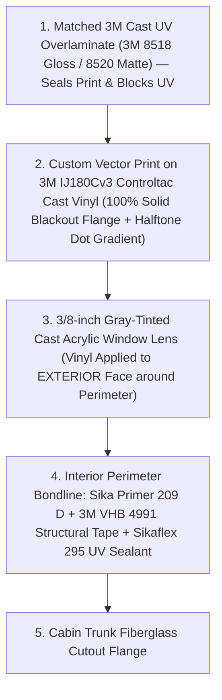

# Fixed Cabin Trunk Acrylic Window & Halftone Frit Refit Guide (2003 Hunter 326 & 2009 Beneteau 40 "Novella")

This guide documents the complete materials sourcing, logistics, optical OpenCV template-to-DXF digitization pipeline, machining/forming options, and **exterior `3M IJ180Cv3` halftone dot-matrix frit emulation** for refitting aged, crazed, and leaking fixed cabin trunk windows across two vessels:
* **2003 Hunter 326**
* **2009 Beneteau Oceanis 40 (*Novella*)**

Combined total glazing area across both boats is **`16–20 sq ft`**, including long, curved coachroof side portlights (`~8 ft × 1 ft`).

---

## 1. Material Selection, Sourcing & Sheet Transport Logistics

### A. Why `3/8"` (`9.5 mm`) Gray-Tinted Cast Acrylic (`Cell-Cast PMMA`)
* **Supplier & Order Reference:** Sourced `4 × 8 ft` (`48" × 96"`) sheets of **`3/8"` gray-tinted cell-cast acrylic** from **Piedmont Plastics** (*Order `RO42811431R0`*).
* **Why Cast Acrylic Over Extruded Acrylic or Polycarbonate:**
  1. **Machinability (Zero Gumming/Melting):** Higher molecular weight cell-cast acrylic machines cleanly under CNC routing, jigsawing, and spiral carbide flush-trimming without melting or gumming up flutes (a severe issue with lower-melt extruded acrylic).
  2. **Chemical & Crazing Resistance:** Cell-cast acrylic has isotropic internal stress and far higher resistance to solvent/sealant stress-crazing than extruded sheet.
  3. **Marine UV & Scratch Durability:** Unlike polycarbonate (`Lexan`), which scratches easily and yellows/hazes under marine UV once its hardcoat wears thin, cell-cast acrylic is inherently UV-stable for `15–25+ years` and can be wet-sanded and buffed if scratched.

### B. Sheet Transport (`4 × 8 ft` Full Sheets)
Transporting `3/8"` cast acrylic sheets (`~46 lbs` per `4×8 ft` sheet) requires keeping the sheets **supported flat** to prevent wind-whip flexing, vibration cracking, or protective masking damage in transit:
* **Option 1 — U-Haul Cargo Van:** Fits `4 × 8 ft` sheets flat on the cargo floor between the wheel wells (or supported on a flat plywood/2×4 cradle angled smoothly over a wheel well), fully enclosed from highway wind buffeting.
* **Option 2 — `5 × 8 ft` Open Utility Trailer:** Allows flat horizontal loading with a sacrificial sheet of plywood or cardboard top-and-bottom sandwich and wide ratchet straps (never cinch bare straps across unsupported acrylic edges).
* **Option 3 — Home Depot `Load 'N Go` Flatbed Pickup/Truck:** Quick local rental for flat-bed transport from the Piedmont Plastics warehouse.

---

## 2. Pattern Digitization & OpenCV CAD/CAM Pipeline

Because large marine cabin windows (`up to 96" × 12"`) feature subtle compound curves and non-parallel tapers—and because fiberglass deck cutouts often vary slightly from port to starboard—measuring by hand with a tape measure is error-prone.

### Step-by-Step Digitization Workflow
1. **Physical Paper Template Tracing:**
   * Remove the original cabin windows and strip residual bedding sealant from the edges.
   * Lay each original window flat onto heavy builder/template paper and trace the exact perimeter with a fine-point marker.
   * Draw precision **`12.0"` (`304.8 mm`) orthogonal `+` calibration crosshairs** along both the $X$ (length) and $Y$ (height) axes inside/around the traced profile.
2. **Flat-Plane Photographic Capture:**
   * Photograph the paper templates from directly overhead using high-resolution smartphone sensors (**iPhone 17 Pro** or **Samsung Galaxy S26 Ultra**), keeping the camera plane parallel to the template floor.
3. **Automated Rectification & Vector Extraction ([`process_window_templates.py`](process_window_templates.py)):**
   * **Sub-Pixel Crosshair Detection & Planar Homography:** Detects the `12.0"` `+` calibration crosshairs (with quadratic/centroid sub-pixel refinement) and computes a planar homography matrix (`cv2.findHomography` / `cv2.getPerspectiveTransform`) to eliminate perspective tilt and lens distortion, warping the image onto a true orthographic plane at `200 PPI`.
   * **Contour Extraction & B-Spline Smoothing:** Applies adaptive thresholding and morphological cleanup to isolate the traced perimeter, then fits periodic B-splines (`scipy.interpolate.splprep` / `splev`) and Douglas-Peucker polylines (`cv2.approxPolyDP`) to preserve fair marine sheer lines.
   * **1:1 CAD Output & Verification:** Exports native `1:1` inch-scaled **DXF** (`LWPOLYLINE` and `SPLINE` entities, `$INSUNITS = 1`), **1:1 SVG** artwork (used directly to generate the vinyl frit blackout border), and a **visual verification PNG/SVG overlay** with computed overall length, max height, bounding-box diagonals, and perimeter length for physical cross-checking against the old window.

---

## 3. Cutting, Edge Finishing & Thermal Forming Options

### A. Cutting the `3/8"` Cast Acrylic Blanks

| Method | Process & Tooling | Best Use Case & Trade-Offs |
| :--- | :--- | :--- |
| **Option 1: DIY Jigsaw + Spiral Flush-Trim Router** | 1. Rough-cut blank `1/16"` to `1/8"` (`1.5–3.0 mm`) oversize using a jigsaw with a fine-tooth **plastic-specific blade (`BOSCH T101A` / `T102BF`)** at medium speed with zero orbital action (prevents friction melting and back-side chipping). 2. Clamp the original window (or a CNC-cut MDF master pattern) to the blank and flush-trim on a router table or handheld router using a **bearing-guided solid carbide spiral up/down-cut flush-trim bit**. | **Low out-of-pocket cost:** Replicates the exact physical window immediately; requires careful clamping on `8-ft` long ports and manual edge chamfering/sanding (`220` $\rightarrow$ `400` grit). |
| **Option 2: Commercial Annapolis CNC Routing (Selected for Matched Pairs)** | Send the `1:1` DXFs from [`process_window_templates.py`](process_window_templates.py) directly to a local **Annapolis CNC routing shop**. Vacuum hold-down table + single-flute `O-flute` carbide acrylic bit (`18,000 RPM`, `150–250 IPM`) cuts the full perimeter and an outer `45°` edge bevel in one pass. | **Factory-grade edge finish:** Zero chatter, zero thermal stress buildup, identical port/starboard symmetry, and effortless repeat cuts if a lens ever needs replacement. |

### B. Curvature & Forming (Cold-Springing vs. Thermal Drape-Forming)
* **Gentle Single-Axis Camber (Cold-Springing):**
  * Over an `8-foot` (`96"`) span, `3/8"` cast acrylic can cold-spring across mild single-axis cabin-side curves (`<1.5"–2"` crown over `8 ft`) when held with temporary mechanical fasteners/clamps during structural adhesive cure—provided residual bending stress is kept well below the `~1,500 PSI` long-term crazing threshold.
* **Pronounced or Compound Curvature (DIY Foil-Polyiso Hot Box at `275°F–300°F`):**
  * Where the cabin trunk has a tighter bend radius or compound twist, cold-springing introduces excessive peel stress on the `Sikaflex 295 UV` / `3M VHB` bondline and accelerates UV/solvent crazing.
  * **Thermal Forming Setup:** Construct a temporary **insulated hot box** out of **foil-faced polyisocyanurate (`polyiso`) foam board** sized to the `8×1 ft` portlight, heated uniformly to **`275°F–300°F` (`135°C–150°C`)** using dual heat guns / infrared heat lamps and monitored with an IR thermometer / thermocouple.
  * Once the `3/8"` cast acrylic reaches rubbery thermoforming state (`~290°F`), drape-form it over the original window (covered in high-temp felt/flannel to prevent mark-off) and allow slow, uniform cooling below `140°F` before unclamping so zero internal thermal stress is locked into the lens.

---

## 4. Ceramic Frit Emulation: Solid Blackout Border + Halftone Dot Matrix

Modern production yachts (like the 2009 Beneteau 40) feature a black perimeter border with a feathered dot-matrix ("frit") transition around the cabin windows. This border serves two critical functions:
1. **Aesthetics:** Conceals the uneven fiberglass cabin cutout edge, `3M VHB` structural spacer tape, and black `Sikaflex 295 UV` / `Dow 795` adhesive fillet.
2. **Structural UV Shielding:** Blocks solar UV radiation from striking the underlying primer and structural sealant bondline from the outside.

### A. Why True Ceramic Frit & Generic Architectural Films Fail on Marine Acrylic

| Approach | Why It Was Evaluated | Why It Was Rejected |
| :--- | :--- | :--- |
| **True Ceramic Enamel Frit** | Permanent baked ceramic ink used on automotive windshields and tempered glass. | Requires firing in a kiln at **`1,150°F–1,250°F` (`620°C–680°C`)**—strictly for tempered glass. Cast acrylic melts above `320°F` (`160°C`) and depolymerizes/burns above `750°F`. |
| **Off-the-Shelf Pre-Printed Dot Films** (*One Way Dot Gradient*, *Gradient Dot Film 4*, *BDF 4REPP*) | Low-cost roll films with pre-printed dot transitions. | **1. Wrong Geometry:** Fixed linear bands cannot follow curved `8-ft` portlight perimeters or provide a continuous `1.5"–2.5"` `100%` solid blackout flange border around all 4 curved sides. **2. Interior Adhesive Failure:** Designed for flat *interior* building glass; acrylic outgasses water vapor and monomer when heated by sun, bubbling interior PET window films, while marine UV rapidly destroys non-cast adhesives. |

---

### B. The Winning Solution: Custom-Printed `3M IJ180Cv3` Cast Marine Wrap Vinyl + Cast UV Overlaminate (Exterior Application)

1. **Material Stack (`~$150–$250` Total via Local Annapolis Sign/Wrap Shop):**
   * **Base Media:** **`3M IJ180Cv3` (`2 mil` / `50 µm` Cast Controltac Vinyl with Comply v3 micro-air-release channels)**. Because it is a *cast* vinyl (not calendered), it does not shrink back, lift at curves, or crack under marine thermal cycling.
   * **Overlaminate:** Paired with a matched **`3M 8518` (Gloss) or `3M 8520` (Matte) `2 mil` Cast UV Overlaminate** to protect the solvent/UV-cured black ink from salt abrasion, dock line chafe, and UV fade.
   * **Cut Profile:** Contour-cut (`kiss-cut`) on the print shop's wide-format plotter directly from the same `1:1` SVG/DXF vector generated by [`process_window_templates.py`](process_window_templates.py), with the clear center window cutout weeded away so the center viewing area remains `100%` bare optically pure cast acrylic!
2. **Vector Artwork Geometry (Generated from the `1:1` CAD Profile):**
   * **Outer Perimeter Zone (`1.5"` to `2.25"` wide depending on flange width):** `100%` solid opaque black—completely hiding the fiberglass cutout, VHB tape, and structural bedding sealant from view.
   * **Inner Transition Zone (`0.5"` to `0.75"` wide inset):** Parametric halftone dot-matrix gradient stepping smoothly from `80%` dot density down to `15%` dot density (`1.5 mm` $\rightarrow$ `0.5 mm` dot pitch), replicating an OEM automotive/yacht silk-screened ceramic frit.
3. **Why EXTERIOR Application Only (Critical Rule):**
   * **UV Protection Before the Lens:** Mounting the `3M IJ180Cv3` blackout border on the **outside** face of the acrylic stops `100%` of UV radiation *before* it passes through the `3/8"` acrylic sheet to hit the interior bedding sealant (`Sikaflex 295 UV` / `Sika Primer 209 D`).
   * **Zero Outgassing Bubbles:** Cast acrylic absorbs and releases trace moisture (~`0.3%` by weight) and expands `8×` more than glass when solar-heated. Applying vinyl to the interior perimeter traps outgassing against the cabin flange, whereas an exterior perimeter ring with `3M Comply` micro-channels breathes during application and leaves the entire interior bonding face bare for maximum `Sika Primer 209 D` chemical adhesion.
   * **Serviceability:** If the exterior frit border is ever gouged by a boom or dock line 8 years later, it can be peeled and replaced from the deck in 20 minutes without unbedding the structural window!

### C. Exterior Vinyl Frit Application Protocol
1. **Surface Prep:** Peel exterior protective masking from the machined `3/8"` cast acrylic lens; clean with **`70%` Isopropyl Alcohol (IPA) + distilled water** (never use acetone, lacquer thinner, or aromatics on acrylic!).
2. **Dry Center-Hinge Alignment:** Because `3M IJ180Cv3` uses pressure-activated adhesive beads (`Controltac`) and air-egress channels (`Comply`), **always apply DRY** (wet application traps water in air-release channels). Tape the vinyl graphic in exact registration over the lens and hinge from the center outward.
3. **Felt-Edge Squeegee & Mild Conforming Heat:** Work outward using overlapping `45°` strokes with a **microfiber/felt-edge squeegee**, using mild heat (`110°F–130°F`) around any compound curves.
4. **Mandatory Edge Post-Heating (`195°F / 90°C`):** Once applied and trimmed `1/16"` (`1.5 mm`) shy of the outer bevel edge (so deck-wash brushes cannot catch a vinyl lip), **post-heat all vinyl edges and dot-matrix boundaries to `195°F` (`90°C`)** verified with an IR thermometer while firming down with a glove/roller. This breaks the PVC's elastic memory and locks the adhesive into a permanent, watertight marine bond.
